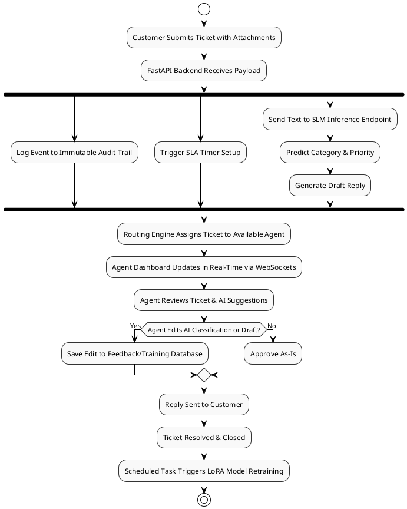

## Slide 1: Title Slide

AI-Driven Intelligent Ticket Routing and SLA Monitoring Using Fine-Tuned Transformers

[AI-Driven Helpdesk Automation Using Fine-Tuned Transformers for Ticket Classification, Intelligent Routing, and SLA Compliance]

**Team Members:**

Durvesh Anil Chavan
WANOLE TEJAS VILAS 
GORE PRATHAMESH NITIN
KULKARNI VIDHI MILIND

*   Wanole Tejas Vilas (331001) | PRN: 22310001[cite: 2]
*   Kale Nirant Manesh (331015) | PRN: 22310432[cite: 2]
*   Shaikh Faraz Abid (331018) | PRN: 22310535[cite: 2]
*   Chavan Durvesh Anil (331022) | PRN: 22310665[cite: 2]

**Course:** Final Year Project · A.Y. 2026-27[cite: 3]
**Internal Guide:** Prof. [Internal Guide Name][cite: 3]
**Department:** Information Technology[cite: 3]
**Institute:** Vishwakarma Institute of Information Technology[cite: 3]

---
## Slide 2: Table of Contents

1. Introduction[cite: 3]
2. Literature Review[cite: 3]
3. Gap Analysis[cite: 3]
4. Problem Statement & Objectives[cite: 3]
5. Proposed System[cite: 3]
6. Technologies to be Used[cite: 3]
7. Expected Results & Analysis[cite: 3]
8. Expected Advantages & Limitations 
9. Conclusion & Timeline[cite: 3]
10. References[cite: 3]

---
## Slide 3: Introduction

**The Problem: Inefficient and Costly Ticket Triage**
Medium and small-scale organizations struggle with manual support ticket handling, leading to delayed responses, incorrect routing, SLA breaches, agent overload, and poor customer satisfaction[cite: 1]. Commercial solutions are expensive, rely heavily on external cloud APIs, and lack on-premise data privacy controls[cite: 1].

**Our Proposal: An In-House AI-Powered System**
We propose building a complete, deployable web-based ticket management system that integrates an in-house fine-tuned Small Language Model (SLM)[cite: 1]. This design aims to provide intelligent automation (classification, routing, and drafting) while maintaining absolute data privacy and low operational costs[cite: 1].

---
## Slide 4: Literature Review (1/3)

| Sr. No | Paper Name | Objective | Methodology | Results | Limitations |
| :--- | :--- | :--- | :--- | :--- | :--- |
| 1 | Improving Support Ticket Systems Using Machine Learning (2022) | Review ML approaches for ticket management | Qualitative synthesis of RF, SVM, and NLP models | RF and SVM identified as best-performing traditional classifiers | Fragmented evidence; lacks standardized evaluation across systems[cite: 4] |
| 2 | Requirements for an IT Support System Based on Hybrid Intelligence (2022) | Derive design requirements for human-AI support systems | Synthesized 24 requirements from 17 literature sources and 21 interviews | Established framework for classification, routing, and human hand-off | Requirements research only; deployed routing quality remains unvalidated[cite: 4] |
| 3 | A Systematic Review of AI and ML-Driven IT Support Systems (2023) | Review AI/ML enhancements in IT service management | Systematic review of 563 relevant studies | Reported 50-60% improvement in classification accuracy | Secondary evidence claims; lacks a reproducible ticket benchmark[cite: 4] |

---
## Slide 5: Literature Review (2/3)

| Sr. No | Paper Name | Objective | Methodology | Results | Limitations |
| :--- | :--- | :--- | :--- | :--- | :--- |
| 4 | Improving IT Support Efficiency Using AI-Driven Ticket Random Forest (2023) | Improve IT support efficiency via ticket classification | IndoBERT text understanding + Random Forest (100 trees) on GLPI tickets | Evaluated 3x3 priority matrix using precision, recall, and F1 | Single-company dataset; struggles with class imbalance; priority scheme too coarse[cite: 4] |
| 5 | Ticket-BERT: Labeling Incident Management Tickets with LMs (2023) | Label multi-class tickets using language models | Fine-tuned Ticket-BERT with active-learning loop | Macro F1 of 98.24% on mixed machine/human-written data | Tied to Azure data; domain transfer unvalidated; lacks routing integration[cite: 4] |
| 6 | Intelligent Ticket Management Assistant for Helpdesk Operations (2025) | Recommend fastest analyst-procedure pairs | Context-aware recommender (CROSS) + synthetic data (SNOOKER) | Recommendation time remains below 0.656 seconds | Requires artificial data due to privacy; AutoML reproducibility is an open issue[cite: 4] |

---
## Slide 6: Literature Review (3/3)

| Sr. No | Paper Name | Objective | Methodology | Results | Limitations |
| :--- | :--- | :--- | :--- | :--- | :--- |
| 7 | Automated Data Classification and Pre-Processing of IT Service Tickets (2025) | Prepare and clean ticket data for ML predictions | R-based language filtering, stemming, and phrase-pattern analysis | Comprehensive data-readiness and cleaning study | No downstream classifier evaluation or routing outcome tested[cite: 4] |
| 8 | AI-Based Classification of IT Support Requests in Enterprise Systems (2026) | Classify highly imbalanced multilingual requests | TF-IDF + Logistic Regression vs. mBERT and XLM-RoBERTa | mBERT achieved Macro F1 of 0.51 compared to LR's 0.39 | High compute/memory costs for transformers; single enterprise setting[cite: 4] |

---
## Slide 7: Gap Analysis

*   **External-API Dependence:** Commercial AI features rely on third-party cloud LLMs, meaning confidential support data must leave the premises[cite: 1].
*   **Missing Feedback Loops:** Published models are often trained once and frozen; agent corrections rarely flow back into retraining pipelines[cite: 1].
*   **SLA & Audit Isolation:** Academic research stops at classification. SLA enforcement, immutable audit trails, and role-based access are seldom integrated into a unified system[cite: 1].
*   **Cost Barriers for SMEs:** SaaS pricing combined with paid AI add-ons is financially unviable for many small to medium organizations[cite: 1].
*   **Point Solutions:** Classifiers are evaluated in isolation rather than dynamically combined with agent skill, workload, and SLA timers for intelligent routing[cite: 1].

---
## Slide 8: Problem Statement & Objectives

**Problem Statement:**
Small and medium organizations handle support tickets manually, causing delayed responses, misrouted tickets, and SLA violations, while commercial AI helpdesks remain costly and push confidential data to external APIs[cite: 3].

**Objectives for the Proposed System:**
*   **Real-Time Full-Stack System:** To design a role-based ticket management web application covering the full lifecycle (submission, routing, dashboarding, and resolution)[cite: 1].
*   **Intelligent Classification:** To fine-tune an in-house Small Language Model (DistilBERT/Qwen2.5) for automated category and priority tagging[cite: 1].
*   **Automated Routing Engine:** To intelligently assign tickets to agents based on AI-predicted categories, SLA limits, and workload[cite: 1].
*   **SLA Monitoring & Escalation:** To define active timers, policies, and automated breach alerts (Email/Telegram)[cite: 1].
*   **Continuous Feedback Loop:** To capture agent corrections to auto-drafts and classifications, appending them to datasets for periodic model retraining[cite: 1].

---
## Slide 9: Proposed System Architecture

```plantuml
@startuml
!theme plain
skinparam componentStyle rectangle
skinparam handwritten false

actor "Customer" as User
actor "Support Agent" as Agent
actor "Admin / Manager" as Admin

node "Client / Browser (React.js)" {
    component "Ticket Submission Form" as Form
    component "Real-Time Agent Dashboard" as Dashboard
    component "Correction UI" as UI
}

node "Application Server (FastAPI / Python)" {
    component "Auth & RBAC" as Auth
    component "SLA Engine & Notifier" as SLA
    component "Audit Logger" as Logger
}

node "Planned In-House AI/ML Pipeline" {
    component "SLM Inference Endpoint\n(DistilBERT / Qwen2.5)" as Inference
    component "Retraining Pipeline (LoRA)" as Retrain
}

database "PostgreSQL Database" {
    folder "Users & Roles"
    folder "Tickets & Attachments"
    folder "Model Feedback Data"
}

User --> Form : Will Submit Ticket
Agent --> Dashboard : Will Review/Reply
Admin --> Dashboard : Will Monitor Metrics

Form --> Auth : WebSockets/HTTP
Dashboard --> Auth : WebSockets/HTTP
UI --> Auth : Corrections

Auth --> SLA : Check Timers
Auth --> Logger : Immutable Logs
Auth --> PostgreSQL Database : Read/Write

Auth --> Inference : Request Classification & Drafts
Inference --> Auth : Return JSON
PostgreSQL Database --> Retrain : Export Training Data
Retrain --> Inference : Update Model Weights
@enduml

```

---

## Slide 10: Technologies to be Used

* **Frontend UI & Client:** React.js, TypeScript, Material-UI (or Tailwind), WebSockets (Socket.io) for real-time dashboard updates.


* **Backend Server:** FastAPI (Python) for fast, asynchronous API interactions and AI endpoint integration.


* **Persistence & Database:** PostgreSQL (Tables: Users, Tickets, Ticket_Interactions, SLA_Policies, Audit_Logs, Model_Feedback).


* **AI/ML Component:** DistilBERT, TinyBERT, or Qwen2.5-0.5B/1.5B, to be fine-tuned using Hugging Face Transformers and LoRA.


* **Infrastructure & Deployment:** Docker containerization, Git for version control, Prometheus/Grafana for SLA monitoring.


---

## Slide 11: Planned System Workflow



---

## Slide 12: Expected Results & Analysis

**Evaluation Plan & Technical Targets**
Testing is planned to be conducted on a governed real-ticket holdout set provided by our industry partner. We aim to establish a baseline using TF-IDF + Logistic Regression/Random Forest for comparison.

| Metric | Baseline Target | Proposed In-House SLM Target |
| --- | --- | --- |
| **Classification Accuracy (Macro-F1)** | ~72% (TF-IDF + Log-Reg) | **≥ 0.85**<br> |
| **Routing Accuracy** | Manual / Static Rules | **≥ 80%** Correct First-Time Assignment

 |
| **SLA Compliance Improvement** | 0% (Baseline) | **+15-20%** via Automated Escalations

 |
| **Inference Latency (CPU)** | N/A (Manual Read) | **< 2 seconds** per ticket

 |

**Hypothesis:** Utilizing a fine-tuned SLM is expected to provide high-accuracy domain-specific comprehension without the extreme latency and privacy risks of commercial LLM API calls.

---

## Slide 13: Expected Advantages & Limitations

**Expected Advantages:**

* **Complete Data Privacy:** On-premise execution ensures confidential ticket data never leaves the organization.


* **Cost Efficiency:** No recurring, per-ticket API costs associated with external commercial LLMs.


* **Domain Adaptability:** A continuous feedback loop will automatically tailor the model to the organization's evolving ticket taxonomy.


* **End-to-End Automation:** Replaces fragmented tools by combining ML routing with hard SLA monitoring and RBAC.


**Anticipated Limitations:**

* **Initial Compute Requirement:** Requires GPU resources for the initial model fine-tuning and the retraining pipeline.


* **Maintenance Overhead:** Demands internal management of the retraining script and database schema.


* **Context Window Limits:** SLMs have smaller context windows compared to massive commercial LLMs, requiring strict input truncation for long email threads.


---

## Slide 14: Conclusion & Timeline

**Conclusion:**
The proposed AI-Powered Support Ticket Management System aims to directly address the inefficiencies of manual triage in medium and small-scale organizations. By integrating an in-house, fine-tuned Small Language Model with a robust React/FastAPI full-stack environment, we intend to automate classification, routing, and drafting. Crucially, this approach eliminates reliance on expensive, privacy-compromising external APIs, creating a cost-effective, self-improving operational tool powered by real agent feedback.

Key Milestones (Target Delivery: 31 August 2026):

* **Friday (FTR 0):** PPT + preliminary code + literature.


* **Mid-August:** Core functionality working (submission → classification → routing → basic dashboard).


* **31st August:** Full system deployed, tested, industry handover-ready, documentation complete.


---

## Slide 15: References (1/2)

1. S. Fuchs, C. Drieschner, H. Wittges (2022). *Improving Support Ticket Systems Using Machine Learning: A Literature Review*.


2. S. L. Schmidt, M. M. Li, C. Peters (2022). *Requirements for an IT Support System Based on Hybrid Intelligence*.


3. S. Ahmed, A. Rahman, M. Ashrafuzzaman (2023). *A Systematic Review of AI and Machine Learning-Driven IT Support Systems: Enhancing Efficiency and Automation in Technical Service Management*.


4. N. Crosley, I. Wasito (2023). *Improving IT Support Efficiency Using AI-Driven Ticket Random Forest Classification Technique*.


---

## Slide 16: References (2/2)

5. Z. Liu, C. Benge, S. Jiang (2023). *Ticket-BERT: Labeling Incident Management Tickets with Language Models*.


6. L. S. Ferreira (2025). *Intelligent Ticket Management Assistant for Helpdesk Operations*.


7. F. Islam, T. Ahmed (2025). *Automated Data Classification and Pre-Processing of IT Service Tickets for Future Machine Learning Predictions*.


8. A. Razma, R. Jurkus (2026). *AI-Based Classification of IT Support Requests in Enterprise Service Management Systems*.


---

## Slide 17: Thank You

**Thank you!**
Questions are welcome.


Here is the Gap Analysis formatted exactly to match your requested style, without any colons:

Here are the shortened versions, reduced by 2 to 3 words each while maintaining the exact format:

External AI APIs Expose Confidential Support Data
Frozen Models Lack Retraining Loops from Agent Corrections
Research Isolates Classification from SLA and Audit Enforcement
Expensive SaaS Subscriptions Create Financial Barriers for SMEs
Isolated Classifiers Ignore Agent Workload in Ticket Routing